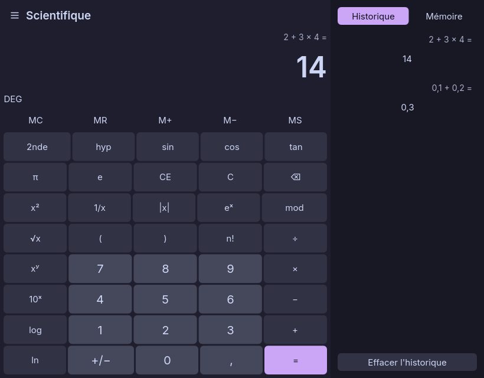

<div align="center">


# Calculette

Standard and scientific calculator for Linux and Wayland, written in Rust with a native Slint interface.

[Releases](https://github.com/Lib-LOCALE/calculatrice/releases) · [Report a bug](https://github.com/Lib-LOCALE/calculatrice/issues)


</div>

## Features

- **Standard and scientific modes:** immediate execution (`2 + 3 × 4 = 20`) or operator precedence (`2 + 3 × 4 = 14`).
- **Decimal arithmetic:** the existing `rust_decimal` engine computes basic arithmetic in decimal (`0.1 + 0.2 = 0.3`). Transcendental functions use `f64`, rounded to 15 significant digits.
- **Scientific functions:** nested parentheses, DEG/RAD/GRAD, inverse and hyperbolic trigonometry, powers, roots, logarithms, factorial, modulo, π and e.
- **History and memory:** recall results and manage individual memory entries. A permanent panel appears at 640 logical pixels; compact windows use a drawer.
- **Eight themes and seven accents:** Catppuccin Mocha, Macchiato, Frappé and Latte, Tokyo Night, Dracula, Nord and Gruvbox.
- **Six languages:** French, English, German, Italian, Spanish and Portuguese, including number formatting and accessible button labels.
- **Native input:** physical numpad codes under Wayland and X11, independent of NumLock. Keyboard navigation and OS accessibility are enabled.

Slint renders the interface directly. No WebKitGTK, Tauri, Node.js or JavaScript runtime is needed to build or run this version. Lower memory use and faster startup are expected benefits, not measured benchmark results.

## Build and run

Requires Rust **1.92 or newer**, a C/C++ build toolchain, and the Linux font/windowing development libraries. On Ubuntu:

```bash
sudo apt install build-essential pkg-config libfontconfig1-dev libfreetype6-dev libxkbcommon-dev libwayland-dev libx11-dev libxcb1-dev libegl1-mesa-dev
cargo test --locked --workspace
cargo run --locked
cargo build --locked --release
```

The executable is `target/release/calculatrice`. Slint uses Winit with FemtoVG by default. A software renderer is included for troubleshooting:

```bash
SLINT_BACKEND=winit-software cargo run --locked
```

## Flatpak

The app ID remains `io.github.Lib_LOCALE.Calculatrice`. The native build uses **org.freedesktop.Platform 25.08**, rather than GNOME/WebKitGTK.

Install Flatpak and `flatpak-builder` (or the `org.flatpak.Builder` app), and configure the Flathub user remote. Then:

```bash
# Build in the Flatpak SDK and install/update the user application
bash scripts/build-flatpak.sh

# Build the bundle without installing it
FLATPAK_SKIP_INSTALL=1 bash scripts/build-flatpak.sh

flatpak run io.github.Lib_LOCALE.Calculatrice
```

The script compiles inside the SDK to avoid linking against a newer host glibc. It updates the installation without deleting user data. Dependencies are fetched with checksums, then Cargo builds offline with the committed lockfile. After changing dependencies, regenerate `flatpak/cargo-sources.json`:

```bash
python3 scripts/generate-cargo-sources.py
```

The manifest deliberately builds the local checkout. For a Flathub submission, replace its directory source with the published Git commit containing this migration; do not reuse the old Tauri commit. Existing releases and the upstream Flathub submission are not changed by a local build.

## Keyboard shortcuts

| Keys | Action |
| --- | --- |
| `0`–`9`, `.` / `,`, numpad | Enter numbers |
| `+`, `-`, `*`, `/`, `Enter` / `=` | Arithmetic and equals |
| `Escape`, `Delete`, `Backspace` | Clear, clear entry, delete digit |
| `Alt+1`, `Alt+2` | Standard / scientific mode |
| `H` | History drawer |
| `Ctrl+C`, `Ctrl+V` | Copy / paste number |
| `Ctrl+L`, `Ctrl+R`, `Ctrl+M`, `Ctrl+P`, `Ctrl+Q` | MC / MR / MS / M+ / M− |
| `F9`, `R`, `Q`, `@`, `%` | Negate / reciprocal / square / square root / percent |
| `(`, `)`, `^`, `!`, `P` | Parentheses / power / factorial / π |
| `S`, `O`, `T`, `L`, `N` | sin / cos / tan / log / ln |

Scientific shortcuts apply in scientific mode. When settings are open, keyboard input is left to its controls. Clipboard availability depends on the compositor's clipboard protocol.

## Preferences and migration

The native app stores language, theme and accent in `$XDG_CONFIG_HOME/io.github.Lib_LOCALE.Calculatrice/preferences.json` (or `~/.config/…`). Invalid settings fall back to defaults. Initial language follows `LC_ALL`, `LC_MESSAGES`, then `LANG`, with French as fallback.

Preferences previously stored in WebKit localStorage are retained on disk but are not imported: select the theme and language once in the native app. As before, memory and calculation history last for the current session.

## Source layout

```text
moteur/                     Pure Rust engine and its 17 original tests
src/main.rs                 Native window, engine callbacks, Winit input
src/native.rs               Key definitions, locale formatting, preferences
src/smoke.rs                Debug-only graphical smoke test
ui/calculatrice.slint       Responsive native interface
ui/data/                    Existing translations, key layers and theme palettes
icons/                      Existing app icons
flatpak/                    Offline build manifest and desktop metadata
scripts/                    SDK bundle build and lockfile source generator
assets/                     Editable original artwork
```

## License

Calculette's source code remains [MIT](LICENSE). Slint is used under its [Royalty-free Desktop, Mobile, and Web Applications License](https://github.com/slint-ui/slint/blob/v1.18.1/LICENSES/LicenseRef-Slint-Royalty-free-2.0.md); the required `AboutSlint` attribution is accessible from the settings menu. Dependencies retain their respective licenses.
