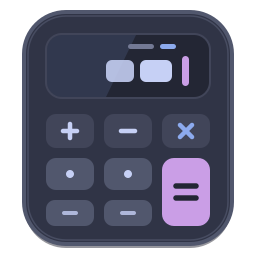
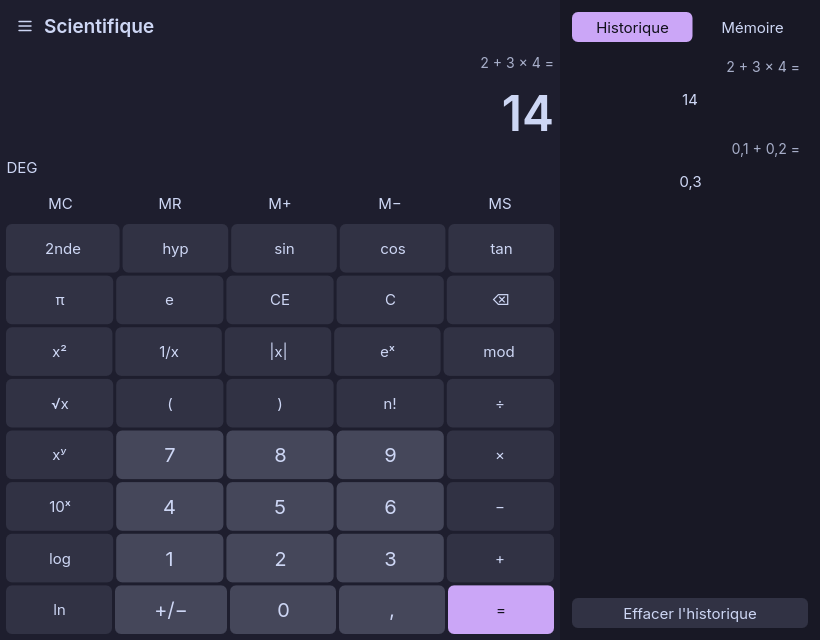
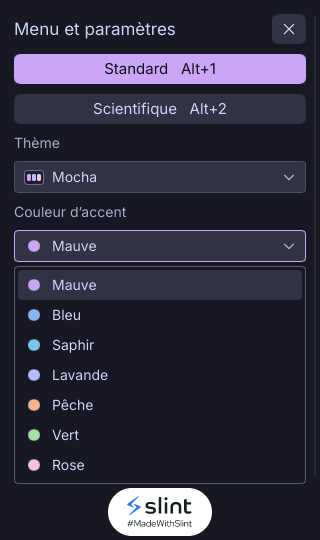

<p align="center"></p>
<h1 align="center">Calculette</h1>
<p align="center"><strong>A native standard and scientific calculator for Linux and Windows.</strong><br>Decimal arithmetic, keyboard-first controls, and a desktop that feels like yours.</p>
<p align="center">An open-source project by <a href="https://github.com/Lib-LOCALE">LibLocale</a>.</p>

<p align="center">
  <a href="https://github.com/Lib-LOCALE/Calculette/releases/latest"></a>
  <a href="https://github.com/Lib-LOCALE/Calculette/actions/workflows/ci.yml"></a>
  <a href="LICENSE"></a>
</p>

<p align="center"><a href="#download">Download</a> · <a href="#features">Features</a> · <a href="#build-from-source">Build from source</a> · <a href="#en-français">En français</a></p>

<p align="center">
  
  
</p>

## Download

Get the matching file from the [latest GitHub release](https://github.com/Lib-LOCALE/Calculette/releases/latest).

| Platform | File | Installation |
| --- | --- | --- |
| Linux x64 · Flatpak | `calculatrice.flatpak` | Open it with your software centre or install with the command below. |
| Linux x64 · native | `calculatrice-linux-x64.tar.gz` | Extract to a folder and run `bash install-linux.sh` there to add Calculette and its icon to your application launcher. |
| Windows 10/11 x64 | `calculatrice-windows-x64.zip` | Extract the ZIP and open `calculatrice.exe`. |

```sh
flatpak --user install --bundle ./calculatrice.flatpak
flatpak run io.github.Lib_LOCALE.Calculatrice
```

The Flatpak requires the Freedesktop runtime. See the [Flatpak guide](flatpak/README.md) for setup and build instructions.

## Features

- **Two calculation modes.** Standard mode evaluates as you go (`2 + 3 × 4 = 20`). Scientific mode applies operator precedence (`2 + 3 × 4 = 14`) and includes nested parentheses, powers, roots, logarithms, trigonometry, DEG/RAD/GRAD, factorial, modulo, π and e.
- **Decimal arithmetic.** Basic calculations such as `0.1 + 0.2` give `0.3`. Transcendental functions use floating point and are rounded to 15 significant digits.
- **History and memory.** Recall results in a drawer on a compact window or a side panel on a wide one. History and memory last for the current session.
- **Eight themes and seven accents.** Preview Catppuccin Mocha, Macchiato, Frappé and Latte, plus Tokyo Night, Dracula, Nord and Gruvbox. Theme and accent previews use the actual app colours.
- **Six languages.** French, English, German, Italian, Spanish and Portuguese, with local number formatting, SVG flags and translated accessibility labels.
- **Native desktop UI.** Written in Rust with Slint. Supports Wayland, X11 and Windows, with keyboard navigation and physical numpad input even when NumLock is off.

| Action | Shortcut | Action | Shortcut |
| --- | --- | --- | --- |
| Standard / scientific | Alt+1 / Alt+2 | History drawer | H |
| Evaluate / repeat | Enter or = | Clear all | Esc |
| Clear entry | Delete | Delete digit | Backspace |
| Copy / paste | Ctrl+C / Ctrl+V | Negate | F9 |
| Memory clear / recall | Ctrl+L / Ctrl+R | Memory store | Ctrl+M |
| Memory add / subtract | Ctrl+P / Ctrl+Q | Reciprocal / square | R / Q |
| Square root / percent | @ / % | Power / factorial | ^ / ! |
| Sin / cos / tan | S / O / T | Log / ln | L / N |

## Build from source

Use Rust **1.92 or newer** and a C/C++ toolchain.

```sh
git clone https://github.com/Lib-LOCALE/Calculette.git
cd Calculette
# Build dependencies on Debian or Ubuntu
sudo apt install build-essential pkg-config libfontconfig1-dev libfreetype6-dev \
  libxkbcommon-dev libwayland-dev libx11-dev libxcb1-dev libegl1-mesa-dev
cargo build --release --locked
./target/release/calculatrice
```

On Windows, use the MSVC or MinGW-w64 toolchain, then run `cargo build --release --locked` and open `target\release\calculatrice.exe`. See `calculatrice --help` for command-line options. On Linux, `SLINT_BACKEND=winit-software` selects the software renderer.

Run the test suite with `cargo test --workspace --locked`. See the [validation notes](docs/validation/slint-migration.md) for the scope of platform and UI checks. Found a bug or have an idea? [Open an issue](https://github.com/Lib-LOCALE/Calculette/issues) with your platform and steps to reproduce it.

## En français

**Calculette**, par **LibLocale**, est une calculatrice de bureau libre pour Linux et Windows. Elle combine les modes standard et scientifique, le calcul décimal, l’historique, la mémoire, huit thèmes et six langues. [Télécharger la dernière version](https://github.com/Lib-LOCALE/Calculette/releases/latest) · [Signaler un problème](https://github.com/Lib-LOCALE/Calculette/issues)

## Credits and licences

- Application code under the [MIT licence](LICENSE). Editable icon sources are in [assets](assets).
- Interface powered by [Slint](https://slint.dev/) under its [Royalty-free Desktop, Mobile, and Web Applications License](https://github.com/slint-ui/slint/blob/v1.18.1/LICENSES/LicenseRef-Slint-Royalty-free-2.0.md).
- Inter under the [SIL Open Font License](ui/fonts/OFL.txt). Flag SVGs from [flag-icons](https://github.com/lipis/flag-icons) under [MIT](ui/icons/flags/LICENSE-flag-icons.txt).

<p align="center"><a href="https://slint.dev"></a></p>
